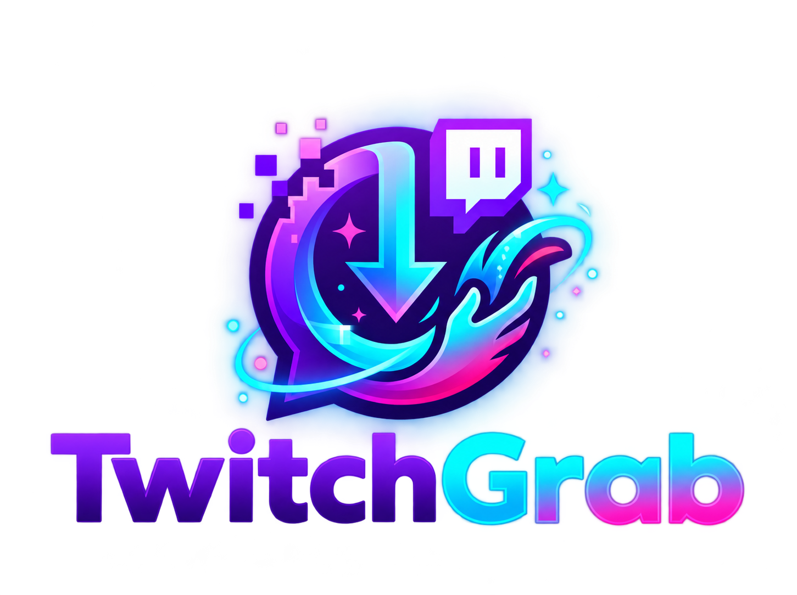
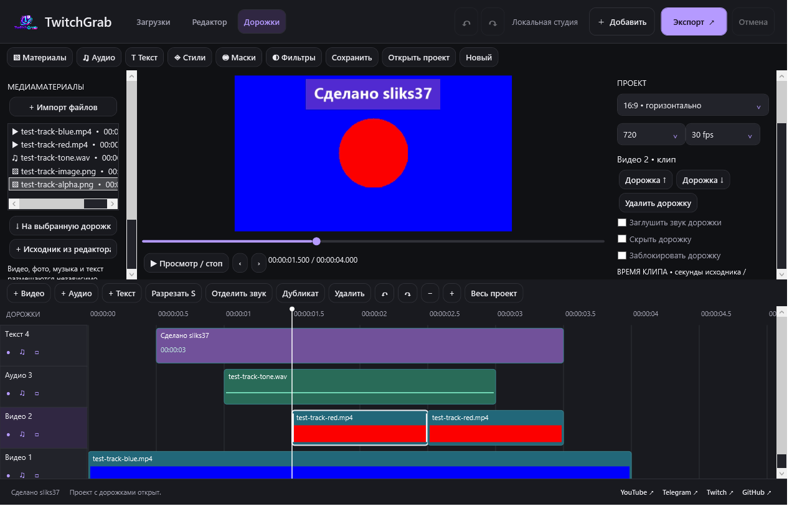

# TwitchGrab Studio

<p align="center">
  
</p>
<p align="center"><strong>Скачай стрим. Собери момент. Выпусти видео.</strong></p>
<p align="center">Загрузчик Twitch и локальный видеоредактор для Windows — сделано <a href="https://github.com/slikscs2">sliks37</a>.</p>
<p align="center">
  
  
  
  
</p>
<p align="center">
  <a href="https://github.com/slikscs2/TwitchGrab-Studio/releases/latest"><strong>Скачать для Windows</strong></a> ·
  <a href="CHANGELOG.md">Что нового</a> ·
  <a href="docs/README.txt">Инструкция</a> ·
  <a href="https://github.com/slikscs2/TwitchGrab-Studio/issues">Сообщить об ошибке</a>
</p>



## От стрима до готового ролика

| Загрузчик Twitch | Монтаж | Оформление |
| --- | --- | --- |
| Лучшее доступное качество | Независимые видео-, аудио- и текстовые дорожки | Вертикальный 9:16, квадрат и 16:9 |
| Записи и текущие прямые эфиры | Перемещение, обрезка, разрезание и дублирование | Круглые, овальные и скруглённые маски |
| Прогресс записи: скачано / всего | Наложение нескольких видео и изображений | Шесть готовых стилей текста |
| Размер, скорость и примерное время | Смешивание звука и отделение аудио от видео | Масштаб, положение, поворот и прозрачность |
| MP4 без перекодирования при упаковке | Отмена, повтор, проекты и автокопии | Фильтры и плавное появление / исчезновение |

В простом редакторе также есть компоновка «игра + вебкамера», импорт SRT/ASS,
цветокоррекция, фоновая музыка и очередь фрагментов. Экспорт — MP4 H.264/AAC,
720/1080 и 30/60 fps. Скорость клипа — 0,5–2× с сохранением высоты голоса.

## Установка

1. Откройте [последний релиз](https://github.com/slikscs2/TwitchGrab-Studio/releases/latest).
2. Скачайте `TwitchGrab-Studio-Setup-v7.0.exe` и запустите установщик.
3. После установки откройте **«Загрузки»**, **«Редактор»** или **«Дорожки»**.

Windows 10/11 x64, .NET Framework 4.8. Установка для текущего пользователя.
Streamlink, Python и FFmpeg включены в установщик.
Перед обновлением закройте программу. Рядом с установщиком публикуется SHA256.
Также в релизе доступна portable-версия: распакуйте архив целиком и запустите EXE.

## Начало монтажа

**Дорожки → Импорт файлов → выберите материал → На выбранную дорожку.**
Первый импортированный файл добавляется на шкалу автоматически.
Добавляйте видео, музыку и текст кнопками над таймлайном. Выберите клип,
чтобы настроить его время, громкость, оформление и маску в правой панели.

- `S` — разрезать у курсора; `Ctrl+D` — дубликат; `Delete` — удалить.
- `Ctrl+Z` / `Ctrl+Y` — отменить / повторить; `Ctrl+S` — сохранить проект.
- Колесо мыши — масштаб шкалы; `Shift` + колесо — прокрутка времени.
- Края клипа — обрезка; `Alt` при перемещении отключает привязку.

## Текущие возможности и ограничения

До 24 дорожек и 80 клипов на проект. Экспорт использует процессор.
Предпросмотр собирается через FFmpeg и показывает до 20 секунд от курсора.
60 fps повторяет кадры, если исходник имеет меньшую частоту; интерполяции нет.
Для эфира итоговая длина заранее неизвестна: отображается ход записи, а не фиктивный процент.
Доступ к закрытым или удалённым записям Twitch не обходится.

Ключевые кадры, автоматические субтитры, трекинг и AI-удаление фона пока отсутствуют.
Параметры простого редактора не переносятся автоматически в многодорожечный проект.

## Сборка из исходников

На Windows x64, из корня репозитория:

```powershell
powershell -NoProfile -ExecutionPolicy Bypass -File scripts/get-engine.ps1
powershell -NoProfile -ExecutionPolicy Bypass -File build.ps1
.\TwitchGrab-Studio.exe
```

Для установщика нужен [Inno Setup 6](https://jrsoftware.org/isinfo.php):

```powershell
& 'C:\Program Files (x86)\Inno Setup 6\ISCC.exe' installer.iss
```

Готовый установщик находится в `dist`. Зависимости загружаются с
[официального релиза Streamlink Windows](https://github.com/streamlink/windows-builds/releases/tag/8.6.2-2)
с проверкой закреплённой SHA256. Исходники зависимостей и лицензии перечислены
в [THIRD_PARTY_NOTICES.md](THIRD_PARTY_NOTICES.md).

## Обновления

У каждой версии — тег, [описание изменений](CHANGELOG.md), установщик,
portable-архив и файл SHA256 в GitHub Releases. Процесс выпуска описан в [RELEASING.md](RELEASING.md).
Источником актуального установщика служит страница Releases.

## Автор

**Сделано sliks37**

[YouTube](https://www.youtube.com/@slikscs2) · [Telegram](https://t.me/sliksy37) ·
[Twitch](https://www.twitch.tv/sliks37) · [GitHub](https://github.com/slikscs2)

Самостоятельный проект; не является официальным продуктом Twitch или CapCut.
